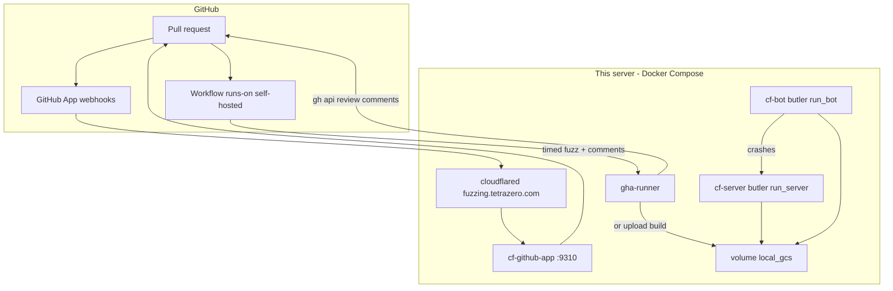
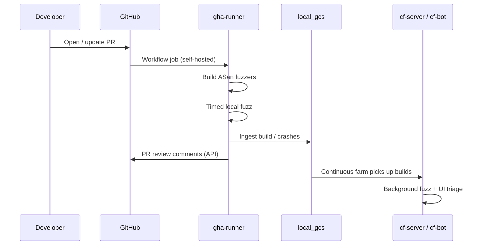

# Architecture

This stack runs **official ClusterFuzz in local mode** on a single Docker host, plus **custom glue** so GitHub pull requests can trigger fuzzing and receive review comments. Production ClusterFuzz on GCP is intentionally out of scope.

## Component diagram

| Service | Image / entrypoint | Responsibility |
| --- | --- | --- |
| `cf-server` | `clusterfuzz-server:local` → `butler.py run_server` | Local web UI (**host** `127.0.0.1:9300`), task scheduling; **`network_mode: host`** |
| `cf-bot` | `clusterfuzz-bot:local` → `butler.py run_bot` | Pulls fuzz tasks, runs fuzzers; same host network + shared `/data` |
| `cf-github-app` | Override `docker-compose.github-app.yml` | Sourcery-style webhooks + timed PR fuzz + App comments (`127.0.0.1:9310`) |
| `cloudflared` | Same override | TLS for `fuzzing.tetrazero.com` → `:9310` |
| `gha-runner` | Override `docker-compose.runner.yml` | Self-hosted CI worker (pilot / cutover path) |
| Shared volume | Host `data/` → `/data` (`deploy/data` → `../data` symlink) | Filesystem GCS at `/data/local_gcs` |

Optional: a one-shot **demo builder** (or script under `deploy/demo-target/`) produces a revisioned zip and drops it into `local_gcs` so continuous bots have something to fuzz before a real repo is wired.

## Data flows

### Continuous fuzzing (always-on farm)

1. Operator (or demo/CI ingest) places **build zips** and job config into the filesystem GCS layout under `local_gcs`.
2. `cf-server` schedules fuzz / minimize / regression tasks against those jobs.
3. `cf-bot` claims tasks, runs the fuzzer against the corpus, and writes crashes, testcases, and corpus updates back through the same storage path.
4. Triage happens in the **ClusterFuzz UI** at `http://localhost:9300` (additional ports such as **9308** may be used for uploads).

This path is entirely **upstream local-mode ClusterFuzz**. No GitHub is required.

### PR-triggered fuzzing (commentable path)

**Preferred:** GitHub App webhooks → `cloudflared` (`fuzzing.tetrazero.com`) → `cf-github-app` (`127.0.0.1:9310`) → timed fuzz → PR comments as the App. See [github-app.md](github-app.md).

**Alternate (pilots):** synchronous timed fuzz on the self-hosted runner.

1. A pull request opens or updates → App webhook **or** Actions workflow `fuzz-pr.yml`.
2. App worker / runner builds and runs a **time-boxed** fuzz session.
3. Crashes and builds may be **ingested into `local_gcs`** so `cf-server` + `cf-bot` continue background fuzzing.
4. `deploy/scripts/post_pr_comments.py` posts **PR review comments** via the GitHub API (installation token or Actions/PAT).

**Important:** The async ClusterFuzz job queue alone is **not** the source of truth for PR comments. Timed fuzz is, so comment latency and mapping stay predictable.

## Upstream vs glue

| Concern | Upstream (`upstream/` = google/clusterfuzz) | Our glue (`deploy/`) |
| --- | --- | --- |
| Local server / bot (`butler.py run_server`, `run_bot`) | Yes | Dockerfiles + compose wrap entrypoints |
| Filesystem “GCS” | Yes (`local_gcs` / `--storage-path`) | Bind-mount under `data/` |
| Official base images (`docker/`, `./build.sh`) | Yes | `build_upstream_images.sh` invokes them |
| App Engine / Firebase / real GCS / Datastore / Pub/Sub / BQ | Production only — **not used** | — |
| GitHub Actions triggers | No | `gha-runner` + `workflows/fuzz-pr.yml` + `docker-compose.runner.yml` |
| Timed PR fuzz / ingest | No | `scripts/run_timed_fuzz.sh`, `scripts/ingest_build.sh` |
| PR review comments | No | `scripts/post_pr_comments.py` |
| Demo C++ overflow target | No | `demo-target/` |
| Host ops docs | Partial (upstream local-instance docs) | This `docs/` tree + `GITHUB_RUNNER.md` |

## Storage layout (conceptual)

Upstream simulates GCS on disk. Under the configured storage root (here: shared volume, typically `data/local_gcs`):

- `…/<bucket>/objects/…` — object bytes (builds, corpora, crashes)
- `…/<bucket>/metadata/…` — object metadata

On this host the shared root is repo-root **`data/`** (compose `../data:/data`; butler `--storage-path /data`). GCS objects live under **`data/local_gcs`**. `deploy/data` is a symlink to `../data` so runner/ingest scripts that resolve paths under `deploy/` hit the same tree.

## Ports and networking

| Port | Typical use |
| --- | --- |
| `127.0.0.1:9300` | ClusterFuzz web UI (host network; remapped from upstream 9000 via `apply_local_ports.sh`) |
| `127.0.0.1:9308` | Local GCS emulator / uploads (remapped from 9008) |

`cf-server` and `cf-bot` **must** share the host network namespace so DATASTORE/PUBSUB/GCS emulator hosts on localhost resolve. Host port conflicts (e.g. another app on `:9300`) block startup — see `BOOTSTRAP_STATUS.md` and [operations.md](operations.md).

## Scaling model

- **Bots:** scale `cf-bot` replicas on the same host/shared volume when CPU/RAM allow.
- **Runners:** one labeled self-hosted runner is the default; org-wide runner groups are optional follow-up.
- **No GCE autoscaling** — there is no cloud bot pool.
